# MICP-椰壳纤维协同固化砂土性能分析与预测系统 V1.0 设计说明书

## 1. 概述

### 1.1 编写目的

本说明书描述 MICP-椰壳纤维协同固化砂土性能分析与预测系统（以下简称"本系统"）的设计背景、总体架构、核心算法、数据结构、模块划分、接口规范、运行流程和操作步骤，作为软件著作权登记的技术文档，同时供开发维护人员参考。操作步骤见第 11 章。

### 1.2 研究背景

微生物诱导碳酸钙沉淀（Microbially Induced Calcite Precipitation，MICP）利用巴氏芽孢杆菌等产脲酶微生物水解尿素，使 Ca²⁺ 以方解石形式沉淀在砂颗粒接触点，形成胶结；掺入椰壳纤维可通过桥接与约束作用改善固化体的脆性和抗崩解性能。该类试验涉及菌液活性、钙源供给、孔隙结构、灌注工艺、纤维掺量等多个耦合因素，单次试验周期长（7~28 天）、成本高，研究人员迫切需要一套能够：

- 把分散的试验数据按项目归档并统一校验；
- 在小样本条件下给出有物理依据的性能预测，而不是单纯的数据拟合；
- 量化各参数对性能的影响程度，指导试验方案设计；
- 在多个性能指标与成本之间给出可解释的优化配比；
- 自动完成统计检验并生成规范化报告

的工具。本系统为此而开发。

### 1.3 设计原则

| 原则 | 落实方式 |
| --- | --- |
| 机理先验 | 所有预测以 MICP 机理模型为基线，机器学习只修正残差，小样本下自动退化为纯机理模型 |
| 可解释 | 预测结果拆分为"机理解释部分 + 数据修正部分"，并给出 8 项中间机理特征 |
| 可复现 | 全部随机过程（采样、交叉验证、Morris 轨迹）使用固定种子 |
| 不外推 | 配比优化默认限制在历史样本的参数包络内 |
| 数据可信 | 三层校验（结构 / 区间 / 物理一致性）、IQR + Grubbs 异常值检测 |
| 轻量部署 | Flask + SQLite 单机即可运行，无外部服务依赖 |

### 1.4 运行环境

- 服务端：Python 3.10 及以上；Flask、NumPy、SciPy、scikit-learn、joblib；SQLite 3
- 客户端：Chrome / Edge / Safari 等现代浏览器（ES2020、Canvas 2D）
- 操作系统：macOS、Linux、Windows 均可

## 2. 总体架构

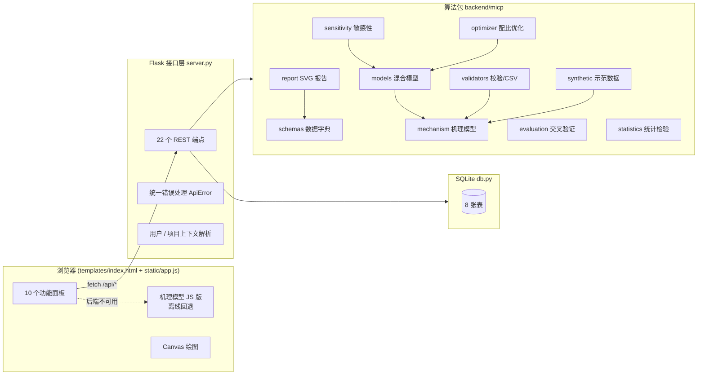

系统分为四层：

1. **表现层**：单页应用，10 个功能面板，全部图表使用 Canvas 2D 自绘，不依赖第三方图表库。前端内置与后端完全一致的机理模型 JavaScript 实现，在后端不可达时切换为"离线机理模式"。
2. **接口层**：`server.py` 只负责解析请求（用户 token、项目 ID、参数）、调用算法包、序列化返回；所有业务逻辑不在此层实现。
3. **算法层**：`backend/micp` 包，10 个模块，纯函数式接口，输入输出均为 Python 原生类型与 NumPy 数组，可脱离 Web 层独立调用与测试。
4. **数据层**：`db.py`，SQLite 单文件数据库，方案与样本以 JSON 文本存储、字段由数据字典约束，便于扩展字段而无需迁移表结构。

## 3. 核心算法设计

### 3.1 机理模型（`mechanism.py`）

机理模型把 8 项试验参数转换为 8 项有物理意义的中间量（机理特征），再推算 7 项性能指标的基线值。全部系数集中在 `MechanismConstants` 数据类中，便于按实际试验数据标定。

**符号**：ρ_d 干密度 (g/cm³)，f 纤维掺量 (%)，V_b 菌液体积 (mL)，OD 菌液 OD600，T 温度 (℃)，C 胶结液浓度 (mol/L)，V_f 胶结液体积 (mL)，N 固化次数。

下列各式是本软件的计算式，系数集中在 `MechanismConstants`。文献对应的是现象和所用函数形式，不是表中每一个常数：菌量增大后反应趋近饱和，饱和项取 Michaelis-Menten 形式[7]；重复灌浆在颗粒接触处沉淀碳酸钙[1]，长砂柱试验中强度提高后土体仍能过水[2]；注入速率过高时化学效率下降；在该文试验的浓度范围内，浓度主要改变孔隙中碳酸钙的分布，总效率变化不大[3]；椰壳纤维直剪试验的较优掺量约为砂重的 0.3%[4]；渗透系数随孔隙率的变化取 Kozeny-Carman 的 \(n^3/(1-n)^2\) 项[5][6]。KB = 50、温度高斯参数、0.75 mol/L、纤维峰 0.40% 等数值由本软件设定。

#### 3.1.1 菌液活性

有效菌量 \(B = V_b \cdot OD\)（mL·OD），脲酶饱和项采用 Michaelis-Menten 形式：

\[ s_B = \frac{B}{K_B + B}, \quad K_B = 50 \]

温度活性因子采用带下限的高斯型，最优温度 30 ℃，标准差 9 ℃：

\[ f_T = 0.25 + 0.75 \cdot \exp\left[-\left(\frac{T - 30}{9}\right)^2\right] \]

#### 3.1.2 孔隙结构与灌注液利用率

初始孔隙率 \(n_0 = 1 - \rho_d / G_s\)（\(G_s = 2.65\)），试样直径取 GB/T 50123—2019 三轴试验规定的 39.1 mm[8]，高度取 80 mm（高径比约 2.05，落在该标准要求的 2.0～2.5 内），体积按 96 cm³ 计，孔隙体积 \(V_p = 96\, n_0\)。灌注液体积远超孔隙体积时多余液体流失，利用率

\[ u = \mathrm{clip}\left(\frac{2.4\, V_p}{V_f},\ 0.35,\ 1\right) \]

#### 3.1.3 高浓度抑制

胶结液浓度超过 0.75 mol/L 后脲酶活性受抑制：

\[ f_C = \exp\left[-\left(\frac{\max(C - 0.75,\ 0)}{1.8}\right)^2\right] \]

#### 3.1.4 逐轮钙源转化与孔隙堵塞

单轮钙源 \(M_c = C \cdot V_f / 1000\)（mol）。第 k 轮（k 从 0 起）的转化效率随已填充孔隙和注入通道衰减而降低：

\[ \eta_k = \eta_{\max} \cdot s_B \cdot f_T \cdot u \cdot f_C \cdot (1 - \varphi_{k-1})^3 \cdot e^{-0.03k}, \quad \eta_{\max} = 0.85 \]

\[ m_{\mathrm{CaCO_3}} = \sum_{k=0}^{N-1} M_c \cdot M_w \cdot \eta_k, \quad M_w = 100.09\ \mathrm{g/mol} \]

每轮后更新孔隙填充率 \(\varphi_k = m_{\mathrm{CaCO_3}} / (\rho_{calcite} V_p)\)，\(\rho_{calcite} = 2.71\)。碳酸钙质量分数 \(w_c = m_{\mathrm{CaCO_3}} / (\rho_d \cdot 96) \times 100\%\)。

#### 3.1.5 纤维桥接因子

采用单峰函数刻画最优掺量 0.40 %，超过 0.75 % 后因团聚而衰减：

\[ F = \frac{f}{f_{opt}} \exp\left(1 - \frac{f}{f_{opt}}\right) \cdot \left[1 - 0.45\, \mathrm{clip}\left(\frac{f - 0.75}{0.25}, 0, 1\right)\right] \]

#### 3.1.6 性能指标基线

| 指标 | 公式 |
| --- | --- |
| 无侧限抗压强度 UCS (kPa) | \( 34 \cdot w_c^{1.08} \cdot (\rho_d/1.6)^{2} \cdot (1 + 0.35F) \) |
| 固化后干密度 (g/cm³) | \( \rho_d (1 + w_c/100) \) |
| 黏聚力 c (kPa) | \( 6 + 3 w_c + 10 F \) |
| 内摩擦角 φ (°) | \( 26 + 10(\rho_d - 1.4) + 2\ln(1 + w_c) + 1.5F \) |
| 渗透系数 k (×10⁻⁴ cm/s) | Kozeny-Carman：\( k = k_{ref}\dfrac{KC(n_0(1-\varphi))}{KC(n_0)}(1 - 0.1F) \)，\(KC(n) = n^3/(1-n)^2\)，\(k_{ref}\) 由 n₀=0.40 时 9×10⁻⁴ cm/s 换算 |
| 浸水崩解率 (%) | \( \max\left(42\, e^{-3.6\varphi}(1 - 0.3F),\ 1.5\right) \) |

8 项机理特征（`FEATURE_KEYS`）：有效菌量指数、脲酶温度活性因子、累计钙源供给量、钙源转化效率、纤维桥接因子、初始孔隙率、孔隙填充率、灌注液利用率。`explain_mechanism()` 把以上链条组织为 5 段中文解释，供预测面板与报告使用。

### 3.2 机理-数据混合模型（`models.py`）

机器学习不直接拟合性能指标，而是拟合**残差**：

\[ \hat{y}(x) = y_{mech}(x) + \sigma_y \odot g_\theta\big([x,\ \phi(x)]\big) \]

- \(x\) 为 8 项原始参数，\(\phi(x)\) 为 8 项机理特征，设计矩阵为 16 维；
- \(g_\theta\) 为残差学习器，训练目标为 \((y - y_{mech}) / \sigma_y\)，按指标标准差归一化，避免 kPa 量级的 UCS 支配损失函数；
- 输出经物理可行域裁剪：UCS ≥ 0，CaCO₃ ∈ [0, 60]%，崩解率 ∈ [0, 100]%，渗透系数 ≥ 0.01，内摩擦角 ∈ [10°, 60°]，固化后干密度 ∈ [1.0, 2.6]。

三种学习器：

| 名称 | 实现 | 关键参数 |
| --- | --- | --- |
| ensemble 随机森林残差模型[13] | `MultiOutputRegressor(RandomForestRegressor)` | 240 棵树，样本 < 60 时 max_depth=8，max_features=0.6 |
| gbrt 梯度提升残差模型[12] | `MultiOutputRegressor(GradientBoostingRegressor)` | 180 轮，学习率 0.05，深度 3，subsample 0.85 |
| bp BP 神经网络残差模型 | `StandardScaler + MLPRegressor` | 隐层 (48, 24)，ReLU，Adam，L2=1e-3 |

模型解析优先级（`resolve_model`）：已存模型 → 样本数 ≥ 8 时临时训练 → 纯机理回退（返回 `fallback=true` 与 `requested`）。缺少 `featureNames` 的旧版模型视为不兼容并忽略。模型以 joblib 序列化后 base64 存入 SQLite。

`decompose()` 返回 `{baseline, correction, final}` 三组 7 项指标，恒有 baseline + correction = final。

### 3.3 模型评估（`evaluation.py`）

自适应 K 折交叉验证：样本数 n < 8 不评估；n < 15 取 3 折；n < 60 取 5 折；否则 10 折（`KFold(shuffle=True, random_state=42)`）。

对每个学习器输出：

- `validation`：折外预测（OOF）的逐指标 R²、RMSE、MAE、MAPE 及综合值（逐指标平均）；
- `train`：全量训练后在训练集上的同一组指标；
- `baseline`：纯机理模型在同一数据上的指标，作为对照；
- `overfitGap` = 训练 R² − 验证 R²，附中文结论；
- `evaluate_all()` 按验证综合 R² 排序给出 `recommended` 与 `ranking`。

### 3.4 敏感性分析（`sensitivity.py`）

三种互补方法，输入均为向量化预测函数 `predictor(matrix) -> (n, 7)`：

1. **OAT 弹性系数（局部）**：围绕当前方案，每个参数在其区间宽度 ±10% 处取中心差分，无量纲弹性 \(E_{ij} = (\Delta y_j / y_j) / (\Delta x_i / x_i)\)。参数重要度 = 7 项指标 |E| 的均值，归一化为合计 100%。
2. **Morris 基本效应（全局筛选）**：在单位超立方上生成 r 条轨迹（默认 12，水平数 6，Δ = 0.6），每条轨迹按随机顺序逐参数移动，基本效应 \(EE_i = [y(x + \Delta e_i) - y(x)] / \Delta\)[9]。μ* 为基本效应绝对值的均值，用来避免正负效应抵消[10]；σ 为标准差。页面同时给出 σ/μ*，大于 1 时标出。评估次数 = r × (k+1) = r × 9。轨迹数限定在 4～60。
3. **单参数响应曲线**：固定其余参数于当前方案，单参数在其区间均匀取 15 点，输出 7 项指标响应。界面称“偏依赖曲线”。Friedman 的偏依赖是对其余变量在样本上取平均[12]，本曲线不是那个量。

### 3.5 多目标配比优化（`optimizer.py`）

目标函数（最大化）：

\[ J(x) = \sum_i w_i\, g_i(x), \quad g_i = \begin{cases} \dfrac{y_i - \min_i}{\max_i - \min_i} & \text{越大越好} \\[6pt] \dfrac{\max_i - y_i}{\max_i - \min_i} & \text{越小越好 / 成本} \end{cases} \]

相对成本指数：\( \mathrm{cost} = N \cdot \left(0.4\dfrac{V_b \cdot OD}{900} + 0.6\dfrac{C \cdot V_f}{900}\right) \times 100 \)

默认权重：UCS 0.30、崩解率 0.15、渗透系数 0.10、CaCO₃ 0.10、黏聚力 0.05、内摩擦角 0.05、成本 0.25。

求解流程：

1. 搜索域 = 参数字典区间 ∩ 用户边界 ∩（可选）历史样本包络（外扩 5%）；用户固定的参数不参与采样；
2. 拉丁超立方 400 点全局采样[11]；
3. 两轮局部细化：取得分前 6 的候选，各生成 40 个高斯扰动子代（σ = 区间宽度 × 0.08 / 轮次）；
4. 去重后统一评估，输出 Top-N（参数四舍五入后去重）、UCS-成本 Pareto 前沿（成本升序扫描非支配点）与全部评估点散点。

`rank_schemes()` 复用同一评分函数对用户已有方案排序。

### 3.6 统计分析（`statistics.py`）

- **异常值**：先按 Tukey 的四分位距围栏粗筛（k=1.5）[15]，再对 n ≥ 7 的数据做迭代 Grubbs 检验（α=0.05，最多 5 轮，临界值 \(G_{crit} = \frac{n-1}{\sqrt n}\sqrt{\frac{t^2}{n-2+t^2}}\)，\(t = t_{\alpha/2n,\ n-2}\)）[14]。每条被剔除样本记录方法、阈值与数值。
- **描述统计**：7 项指标的 count / mean / std / cv / min / q1 / median / q3 / max / skew。
- **单因素方差分析**：因素取值 ≤ 5 个水平时直接分组，否则按五分位数分箱；分组按因素水平从小到大排列。计算 SS_between、SS_within、F、p（`scipy.stats.f.sf`）、η²，并生成中文结论。报告和页面中 p < 0.0001 时写成“<0.0001”。
- **相关矩阵**：8 参数 + 7 指标共 15 维 Pearson r 与 p 值，提取 |r| 最大且 p < 0.05 的参数-指标对。
- **回归**：UCS-CaCO₃ 线性回归（斜率、截距、R²、p）与幂函数回归（对数空间最小二乘）。

### 3.7 输入校验（`validators.py`）

| 层次 | 规则 | 结果 |
| --- | --- | --- |
| 结构 | 8 项参数（样本还需 7 项指标）必须存在且可转为数值；缺少名称自动命名 | 错误 / 警告 |
| 区间 | 参数落在字典区间内；固化次数取整；指标非负；崩解率 ≤ 100% | 错误 / 警告 |
| 一致性 | 固化后干密度不低于初始干密度（容差 0.02）；UCS 实测与机理估算偏差 > 60% 提示核对单位 | 警告 |

`parse_csv()` 支持 UTF-8（含 BOM）文本，表头通过 `canonical_key()` 映射英文键名、中文名称及常见别名（如"干密度"、"OD值"、"CaCO3"），未识别的表头单独返回。

### 3.8 报告生成（`report.py`）

纯 Python 生成自包含 HTML，内嵌 SVG 图表（柱状图、散点图、分组柱状图），不依赖浏览器端渲染。共 8 章：方案参数、机理解释链条、性能预测与分解、参数敏感性、模型评估、统计分析、配比优化建议、结论。

## 4. 数据字典

### 4.1 试验参数（输入，8 项）

| 键名 | 名称 | 单位 | 合理区间 | 物理含义 |
| --- | --- | --- | --- | --- |
| dryDensity | 砂土干密度 | g/cm³ | 1.2 ~ 2.2 | 制样目标干密度，决定初始孔隙比 |
| fiberContent | 椰壳纤维掺量 | % | 0 ~ 1.0 | 纤维质量占干砂质量百分比 |
| bacterialVolume | 菌液用量 | mL | 10 ~ 300 | 单次灌注菌液体积 |
| odValue | 菌液 OD600 | - | 0.2 ~ 3.0 | 菌液光密度，表征细胞浓度 |
| temperature | 固化温度 | ℃ | 20 ~ 40 | 养护环境温度 |
| cementationDose | 胶结液浓度 | mol/L | 0.1 ~ 3.0 | 尿素-氯化钙等摩尔胶结液浓度 |
| fixationVolume | 胶结液用量 | mL | 10 ~ 300 | 单次灌注胶结液体积 |
| cycles | 固化次数 | 次（整数） | 1 ~ 10 | 菌液-胶结液交替灌注轮次 |

### 4.2 性能指标（输出，7 项）

| 键名 | 名称 | 单位 | 优化方向 | 测试方法 |
| --- | --- | --- | --- | --- |
| ucs | 无侧限抗压强度 | kPa | 越大越好 | 单轴压缩 |
| postDryDensity | 固化后干密度 | g/cm³ | 越大越好 | 烘干称重 |
| disintegrationRate | 浸水崩解率 | % | 越小越好 | 浸水 24 h 质量损失 |
| permeability | 渗透系数 | ×10⁻⁴ cm/s | 越小越好 | 常水头渗透 |
| frictionAngle | 内摩擦角 | ° | 越大越好 | 直剪 |
| cohesion | 黏聚力 | kPa | 越大越好 | 直剪 |
| caco3 | 碳酸钙含量 | % | 越大越好 | 酸洗法 |

### 4.3 机理特征（中间量，8 项）

effectiveBacteria 有效菌量指数 (mL·OD)、temperatureFactor 脲酶温度活性因子、calciumSupply 累计钙源供给量 (mol)、conversionEfficiency 钙源转化效率、fiberBridging 纤维桥接因子、initialPorosity 初始孔隙率、poreFillingRatio 孔隙填充率、liquidUtilization 灌注液利用率。

## 5. 数据库设计

约束：`schemes(project_id, scheme_name)`、`dataset(project_id, sample_id)`、`model_store(project_id, model_name)` 唯一；`model_history` 建有 `(project_id, model_name, version)` 索引。密码使用 Werkzeug `generate_password_hash`（scrypt）存储；会话 token 为 48 位随机字符串。首次启动自动创建默认项目并写入 4 个示范方案与 48 条示范样本。

## 6. 模块与函数清单

| 模块 | 主要函数 / 类 | 说明 |
| --- | --- | --- |
| micp/schemas.py | `ParamSpec`、`MetricSpec`、`PARAM_SPECS`、`METRIC_SPECS`、`FEATURE_SPECS`、`canonical_key()`、`describe_dictionary()` | 数据字典与表头别名映射 |
| micp/mechanism.py | `MechanismConstants`、`mechanism_features_matrix()`、`mechanism_baseline_matrix()`、`mechanism_features()`、`mechanism_baseline()`、`explain_mechanism()`、`design_space_bounds()`、`clip_to_ranges()` | 机理特征与基线 |
| micp/models.py | `build_learner()`、`design_matrix()`、`HybridModel.fit/predict_matrix/decompose/to_payload/from_payload`、`resolve_model()`、`make_batch_predictor()` | 混合模型 |
| micp/evaluation.py | `choose_folds()`、`metric_table()`、`cross_validate()`、`evaluate_all()` | 交叉验证 |
| micp/sensitivity.py | `oat_elasticity()`、`morris_effects()`、`partial_dependence()`、`full_partial_dependence()` | 敏感性 |
| micp/optimizer.py | `cost_index()`、`latin_hypercube()`、`pareto_front()`、`dataset_envelope()`、`optimize()`、`rank_schemes()` | 配比优化 |
| micp/statistics.py | `iqr_bounds()`、`grubbs_outliers()`、`detect_outliers()`、`describe()`、`one_way_anova()`、`correlation_matrix()`、`fit_relationship()`、`analyze_dataset()` | 统计分析 |
| micp/validators.py | `validate_row()`、`validate_rows()`、`parse_csv()` | 校验 |
| micp/synthetic.py | `generate_dataset()`、`DEFAULT_SCHEMES` | 示范数据 |
| micp/report.py | `svg_bar_chart()`、`svg_scatter()`、`svg_grouped_bars()`、`build_report_html()` | 报告 |
| micp/__init__.py | `train_models()`、`evaluate_models()`、`predict()`、`partial_dependence()`、`morris()`、`optimize()`、`rank_schemes()`、`recommend_best_scheme()`、`analyze_dataset()`、`correlation()`、`validate_rows()`、`parse_csv()`、`build_report_html()` | 对外门面 |
| db.py | `init_db()`、`create_user()`、`create_session()`、`create_project()`、`upsert_schemes()`、`replace_dataset()`、`save_model()`、`load_model()`、`list_model_history()`、`seed_defaults()` | 数据访问 |
| server.py | `create_app()`、`ApiError`、各端点函数 | 接口层 |
| static/app.js | `mechanismBaseline()`、`predictOffline()`、`runPrediction()`、`trainModels()`、`runMorris()`、`runOptimizer()`、`runAnalysis()`、`runCorrelation()`、`drawPdpChart()`、`drawParetoChart()`、`drawCorrelationMatrix()`、`buildReportHtml()` 等 | 前端逻辑 |

## 7. 接口规范

所有接口前缀 `/api`，请求与响应均为 JSON。除认证接口外均可携带 `Authorization: Bearer <token>` 与 `?projectId=` 指定项目；未指定时使用默认项目。错误统一为 `{ "error": string, "detail": any }`。

| 方法 | 路径 | 请求体要点 | 响应要点 |
| --- | --- | --- | --- |
| GET | /health | - | ok、version、projectId、models[]、sampleCount、minTrainSamples、user |
| GET | /dictionary | - | params[]、metrics[]、features[] |
| POST | /auth/register | username、password（≥ 6 位） | user；409 用户名已存在 |
| POST | /auth/login | username、password | token、user；401 |
| GET | /auth/me | token | user；401 |
| GET / POST | /projects | name、description | projects[] / project |
| GET / POST | /schemes | schemes[] | schemes[]、warnings[]；422 detail=校验结果 |
| GET / POST | /dataset | rows[]、skipInvalid | rows[]、warnings[]、rejected |
| POST | /dataset/validate | kind、rows[] 或 csv | total、accepted、rejected、valid[]、errors[]、warnings[]、unknownHeaders[] |
| POST | /train | - | trainedModels[]、versions{}、recommended、metrics{} |
| POST | /models/evaluate | - | reports{}、recommended、ranking[] |
| GET | /models/history | - | history[]、current[] |
| POST | /predict | scheme 或 schemeName、model、withMorris | model、fallback、metrics{}、decomposition{}、features{}、mechanism[]、sensitivity[]、sensitivityMatrix{} |
| POST | /sensitivity/partial | scheme / schemeName、model、param | param、x[]、curves{}、current |
| POST | /sensitivity/morris | model、trajectories(4~60) | evaluations、overall[]、byMetric{} |
| POST | /optimize | model、weights{}、fixed{}、bounds{}、restrictToData、topN | evaluated、bounds{}、topSchemes[]、pareto[]、scatter[] |
| POST | /schemes/rank | schemes[]、model、weights{} | ranking[]、best |
| POST | /analyze | factor、response | sampleSize、removed、removedDetails[]、metricStats[]、anova{}、regression{} |
| POST | /statistics/correlation | - | keys[]、labels[]、r[][]、p[][]、topPairs[] |
| POST | /report | model、prediction、analysis、evaluation、optimization | html |
| POST | /seed | - | schemes[]、rows[] |

## 8. 关键流程

### 8.1 预测流程

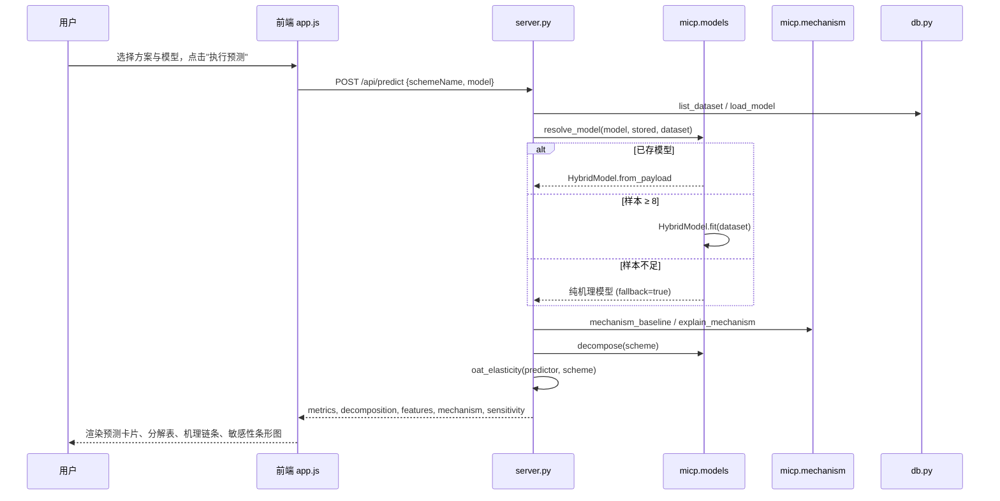

### 8.2 训练流程

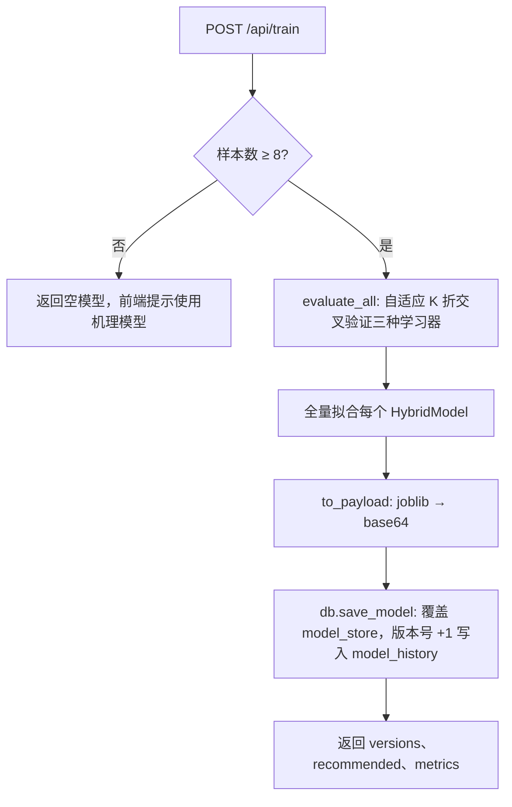

### 8.3 配比优化流程

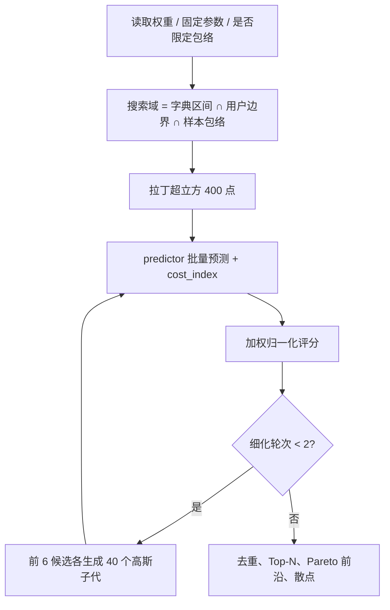

### 8.4 前端离线回退

页面加载时请求 `/api/health`；失败则 `state.online=false`，所有按钮改用 JS 版机理模型（`mechanismBaseline()`、`offlineSensitivity()`、`localPartialDependence()`、`analyzeLocally()`、`correlationLocally()`），方案存于 `localStorage`。依赖后端的功能（交叉验证、Morris、配比优化、模型历史、报告服务端渲染）在离线时给出明确提示。

## 9. 异常处理与安全

- 接口层 `ApiError(message, status, detail)` 统一抛出；`HTTPException` 与未捕获异常分别转换为 JSON 404/405 与 500，并记录堆栈。
- 校验失败返回 422，`detail` 中包含逐行逐字段错误，前端按行高亮。
- 算法依赖缺失（NumPy / scikit-learn 未安装）时服务仍可启动，相关接口返回 503 并附导入错误。
- 密码 scrypt 哈希存储；token 随机生成；写操作（方案、样本、训练、seed）校验用户对项目的访问权。
- 所有随机过程固定种子，保证同一数据集下结果可复现。

## 10. 代码规模

| 部分 | 文件 | 行数（约） |
| --- | --- | --- |
| 算法包 | backend/micp/*.py（11 个） | 2 333 |
| 接口与数据层 | server.py、db.py、ml.py、wsgi.py、bootstrap_admin.py | 965 |
| 前端 | templates/index.html、static/app.js | 2 563 |
| 合计 | | 5 861 |

行数为文件物理行，含空行与注释，不含 README、依赖清单和样式表。源程序 Word 在每个文件前另加一行文件名注释，因此清单总行数多于 5 861。

## 11. 操作说明

页面自上而下为 00～09 十个面板。建议先登录并选定项目，再按面板编号操作。按钮名称与页面一致。

### 11.1 启动

在项目目录执行 `python3 backend/server.py`，浏览器打开 `http://127.0.0.1:9000`。页顶状态为“后端在线”时，全部面板可用。状态为“离线机理模式”时，后端没有连上，参数录入、纯机理预测、单参数曲线和基于本地样本的图表仍可使用；交叉验证、Morris、配比优化、模型历史和报告生成会提示需要后端。

页顶三个按钮：

- **载入示范数据**：写入 4 个方案和 48 条示范样本。
- **训练并交叉验证**：用当前项目样本训练三种残差模型并做交叉验证，完成后刷新评估面板。
- **生成分析报告**：滚到报告面板并生成预览。

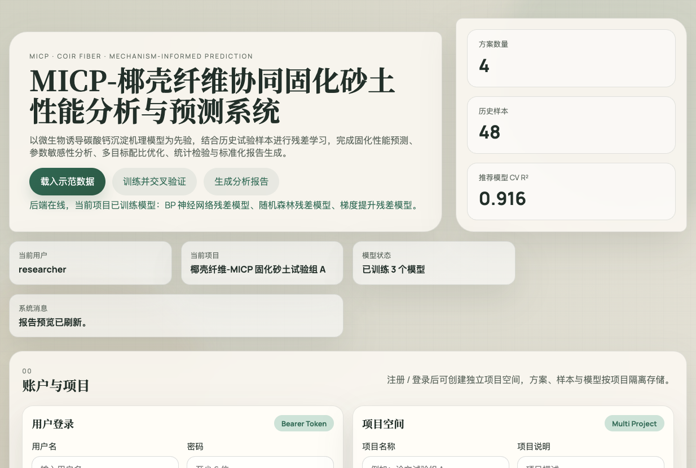

### 11.2 面板 00 账户与项目

1. 填写用户名和密码（至少 6 位），先点 **注册**，再点 **登录**。
2. 填写项目名称和说明，点 **创建项目**。
3. 在“当前项目”中切换项目。方案、样本和模型按项目分开存放。
4. 未登录时，操作都落在公共的“默认项目”。点 **退出** 清除登录状态。

### 11.3 面板 01 试验参数管理

8 个输入框旁标有单位和允许区间。填完后写方案名称，然后：

- **保存方案**：区间和字段检查通过后写入当前项目，并出现在预测面板的方案列表里。不通过时，下方表格列出字段和原因。
- **保存模板**：把当前 8 项参数存在本机浏览器，供以后回填。
- **导出参数表**：下载当前项目全部方案的 CSV。

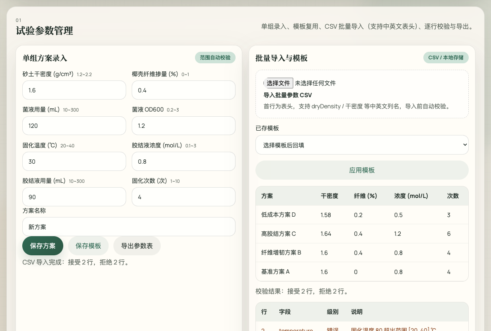

批量导入时，点“导入批量参数 CSV”。首行是表头，英文键名和中文名可以混用，例如 `方案名称,干密度,纤维掺量,菌液用量,OD值,温度,胶结液浓度,胶结液用量,固化次数`。合格行入库；超出区间或缺少字段的行以橙色列出原因；固化后干密度低于初始干密度这类一致性问题以黄色警告，该行仍然接受。

在“已存模板”中选一项，点 **应用模板**，参数回填到表单。

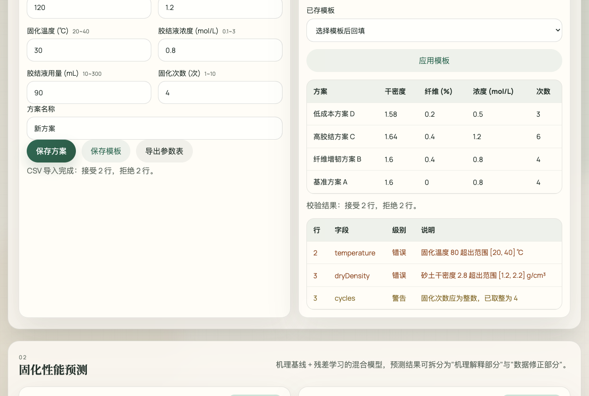

### 11.4 面板 02 固化性能预测

1. 在“选择方案”中选定当前项目的一个方案。
2. 在“模型”中选随机森林残差模型、梯度提升残差模型、BP 神经网络残差模型或纯机理模型。前三种需要该项目至少 8 条样本并已训练；样本不够或尚未训练时，结果会标明已回退到纯机理模型。
3. 点 **执行预测**。右侧给出 7 项指标、分解表（机理基线、数据修正、最终预测）、五段机理解释，以及 8 个参数的 OAT 重要度。数据修正为正时用绿色，为负时用橙色。

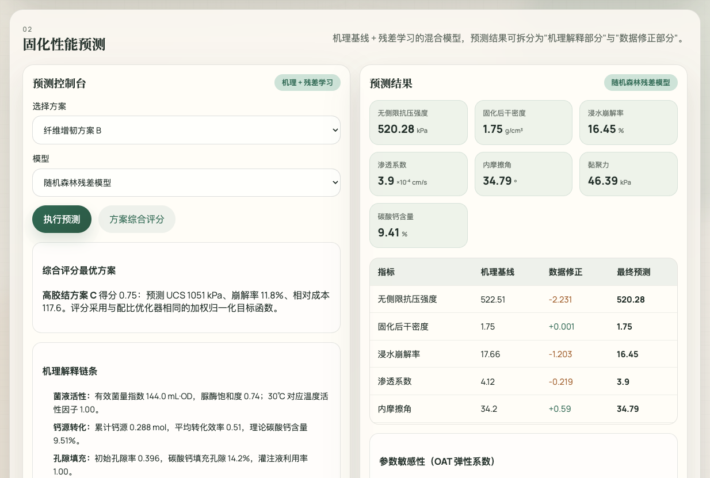

4. 点 **方案综合评分**。当前项目里的方案按默认权重排序，表中列出得分、UCS、崩解率和相对成本，得分最高的一行高亮。

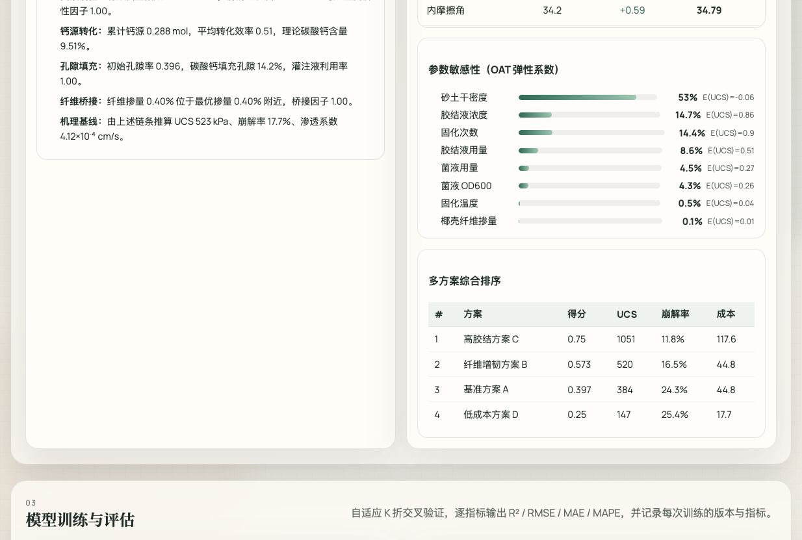

### 11.5 面板 03 模型训练与评估

- **仅评估（不落库）**：只做交叉验证，不保存模型。
- **训练并保存模型**：交叉验证后用全部样本再训练一次并写入数据库，版本号加 1。

结果表按学习器列出折数、验证 R²、验证 RMSE、MAPE、训练 R² 和机理基线 R²。验证综合 R² 最高的一行加粗。表下是该学习器逐指标的验证误差。右侧“模型版本历史”列出每次保存的模型名、版本、样本数、交叉验证 R² 和时间。

折数：8～14 条为 3 折，15～59 条为 5 折，60 条及以上为 10 折。少于 8 条时不评估。

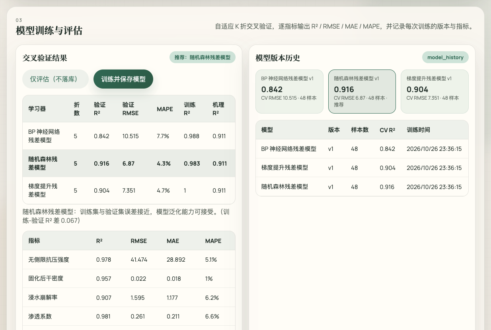

### 11.6 面板 04 敏感性深入分析

单参数曲线：选择扫描参数和响应指标，点 **绘制偏依赖曲线**。其余参数固定为当前方案，该参数在允许区间内取 15 个点。图上的点标出当前方案所在位置。

Morris：轨迹数填 4～60，默认 12。查看指标可选“综合”或单独一项。点 **执行 Morris 分析**。表中 μ* 大的参数主效应强，σ 大表示非线性或与其他参数有交互；σ/μ* 大于 1 的格子为橙色。综合视图下 μ 列显示为“—”，因为七项指标的有符号效应不直接相加。

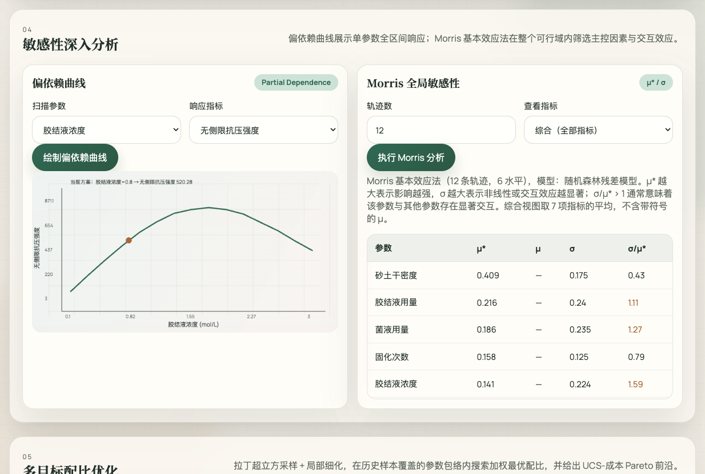

### 11.7 面板 05 多目标配比优化

1. 拖动 7 个权重滑块。滑块数值会自动归一化。默认是 UCS 30、崩解率 15、渗透系数 10、碳酸钙含量 10、黏聚力 5、内摩擦角 5、相对成本 25。
2. “限定在历史样本参数包络内”默认勾选。取消后，搜索范围扩大到数据字典的全区间，预测可能落到样本没有覆盖的参数上。
3. 点 **执行配比优化**。右侧为推荐配比表和 UCS–相对成本图：蓝点是候选配比，橙线是非支配前沿，绿圈是当前权重下得分最高的点。

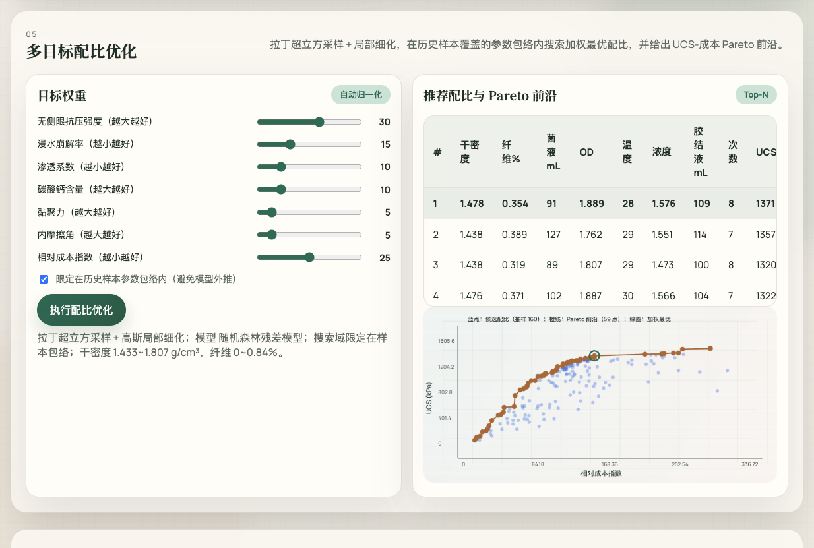

### 11.8 面板 06 试验数据处理

- **导入历史试验数据**：CSV 同时包含 8 项参数和 7 项指标。不合格行列出后跳过。
- **导出历史样本**：下载当前项目样本。
- **恢复示范样本**：重新写入 48 条内置样本。

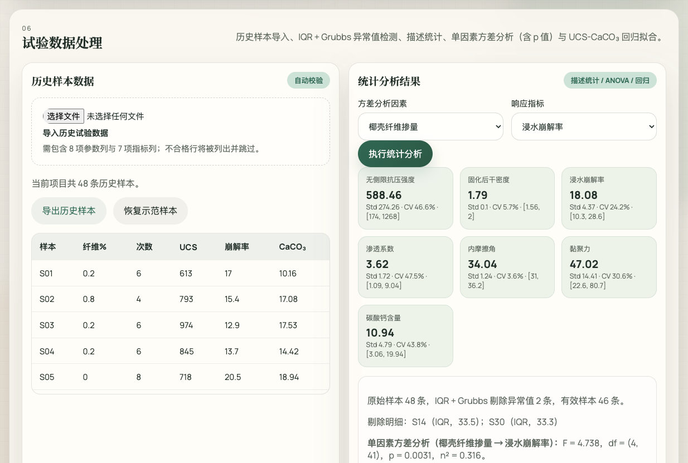

统计分析：选择方差分析因素和响应指标，点 **执行统计分析**。页面给出异常值明细（样本号、IQR 或 Grubbs、界限和数值）、7 项指标的均值、标准差和变异系数、按因素水平从小到大排列的分组表，以及 F、自由度、p 和 η²。p 小于 0.0001 时写成“<0.0001”。同一结果里还有 UCS 与碳酸钙含量的线性式和幂函数式。

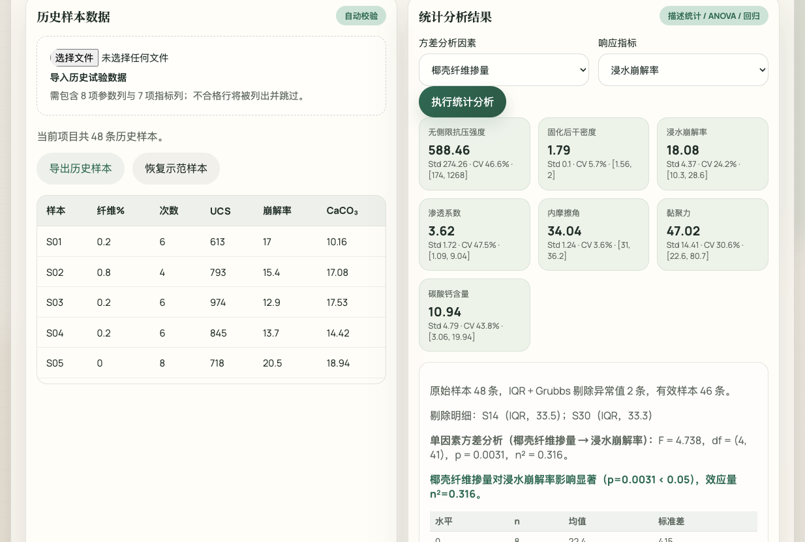

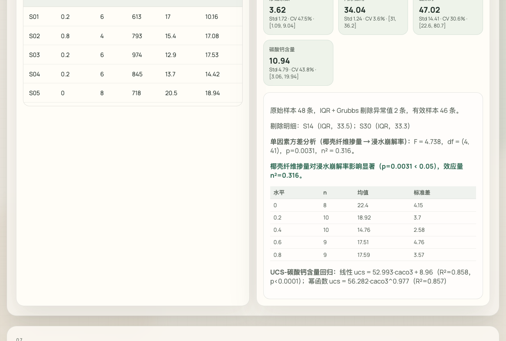

### 11.9 面板 07 相关性分析

点 **计算相关矩阵**。图为 15×15 的 Pearson 矩阵，绿色为正、橙色为负，颜色深浅对应 |r|。右侧表列出 |r| 较大且 p < 0.05 的参数–指标对；p 小于 0.001 时写成“<0.001”。

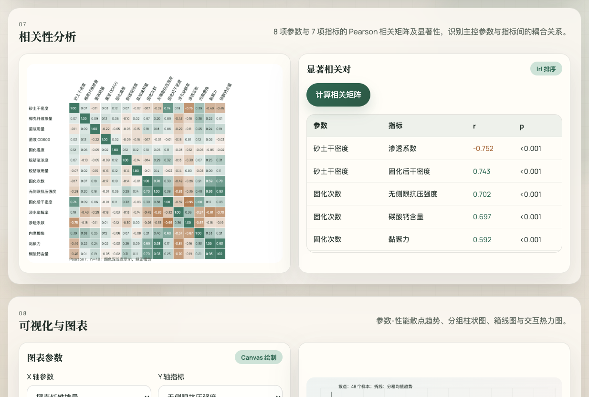

### 11.10 面板 08 可视化

选择 X 轴参数、Y 轴指标和图表类型（参数-性能趋势、分组柱状图、箱线图、热力图），点 **更新图表**。图用的是当前项目的历史样本。

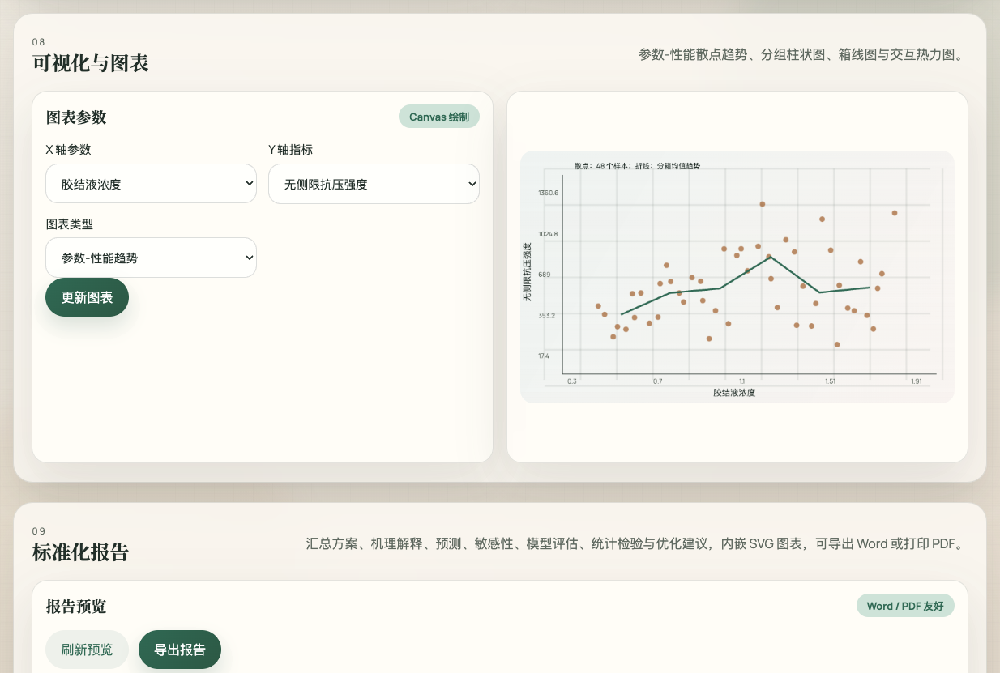

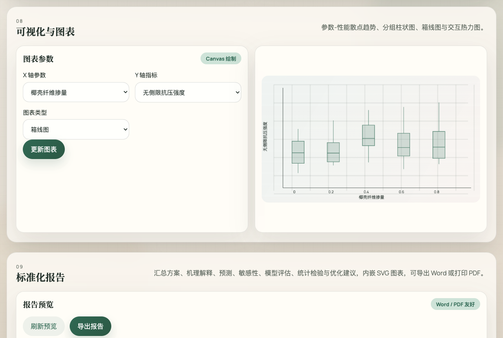

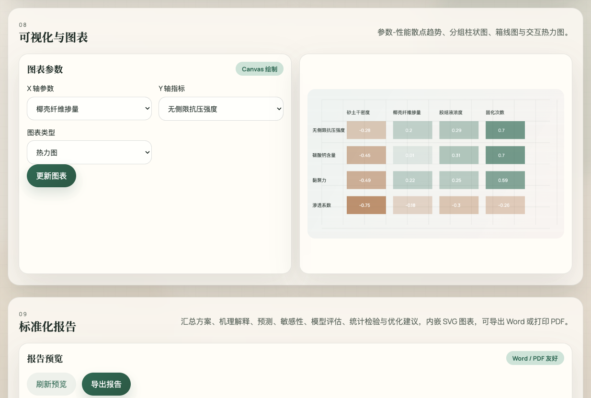

### 11.11 面板 09 标准化报告

1. 先在预测、统计或优化面板得到结果，再点 **刷新预览**。预览列出用户、项目、模型和生成时间，正文为八章 HTML，图是 SVG。
2. 点 **导出报告** 下载 `.doc`。也可以在浏览器里把预览打印成 PDF。

报告章节依次为方案参数、机理解释、预测分解、参数敏感性、模型评估、试验数据统计、配比优化与方案推荐、结论与建议。

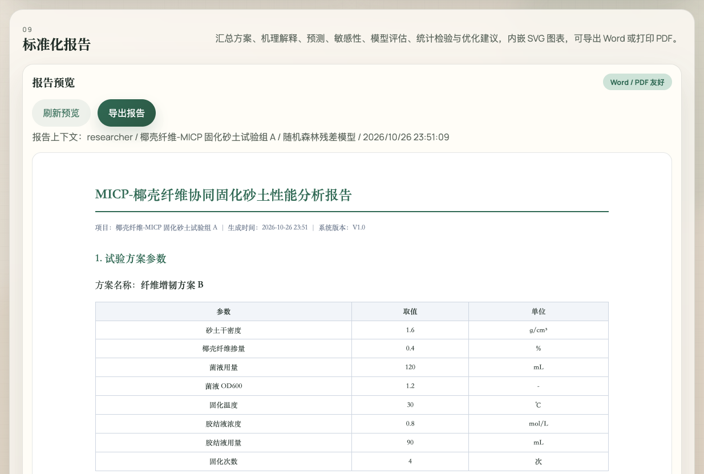

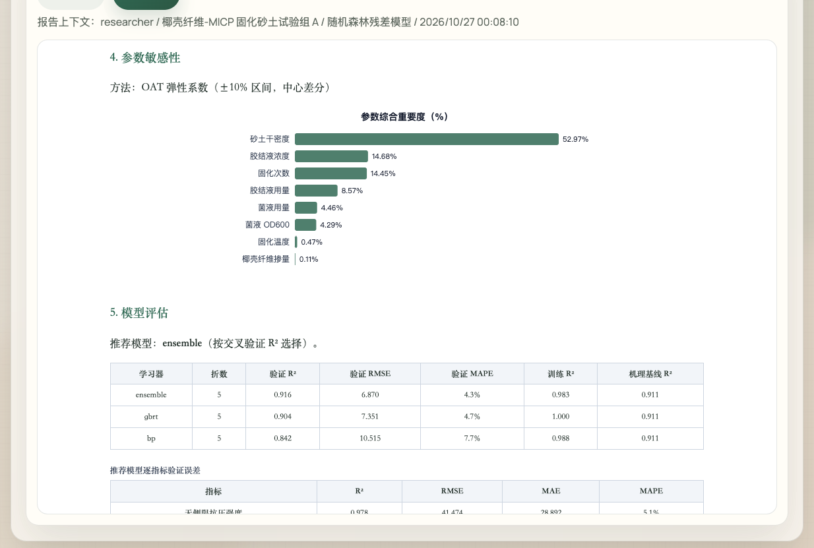

### 11.12 常见问题

| 现象 | 处理 |
| --- | --- |
| 预测标明已回退到纯机理模型 | 当前项目样本少于 8 条，或所选模型还没训练。导入样本后点“训练并交叉验证” |
| 导入后提示未识别的表头 | 表头与第 4 章数据字典或接口 `/api/dictionary` 的别名不一致。可改用“干密度”“OD值”这类中文列名 |
| 方差分析提示样本或分组数量不足 | 该因素的取值太少，或有效样本少于两组。换一个因素，或补样本 |
| 优化得到的 UCS 明显高于历史样本 | 多半取消了样本包络限制。重新勾选后再算 |
| 页顶为离线机理模式 | 后端没启动，或 9000 端口被占用。启动 `backend/server.py` 后刷新 |
| 登录后项目列表是空的 | 点“创建项目”。未建项目时只能看到默认项目 |

## 12. 参考文献

[1] DeJong J T, Fritzges M B, Nüsslein K. Microbially induced cementation to control sand response to undrained shear[J]. Journal of Geotechnical and Geoenvironmental Engineering, 2006, 132(11): 1381-1392.

[2] Whiffin V S, van Paassen L A, Harkes M P. Microbial carbonate precipitation as a soil improvement technique[J]. Geomicrobiology Journal, 2007, 24(5): 417-423.

[3] Al Qabany A, Soga K, Santamarina C. Factors affecting efficiency of microbially induced calcite precipitation[J]. Journal of Geotechnical and Geoenvironmental Engineering, 2012, 138(8): 992-1001.

[4] Joga S P R, Mallikarjuna Rao K. Influence of shear strength parameters on loose fine sand treated with coir fiber and microbially induced calcite precipitation[J]. Discover Geoscience, 2024. DOI: 10.1007/s44288-024-00071-9.

[5] Carman P C. Flow of gases through porous media[M]. London: Butterworths, 1956.

[6] Carrier W D III. Goodbye, Hazen; Hello, Kozeny-Carman[J]. Journal of Geotechnical and Geoenvironmental Engineering, 2003, 129(11): 1054-1056.

[7] Michaelis L, Menten M L. Die Kinetik der Invertinwirkung[J]. Biochemische Zeitschrift, 1913, 49: 333-369.

[8] 中华人民共和国住房和城乡建设部. 土工试验方法标准: GB/T 50123—2019[S]. 北京: 中国计划出版社, 2019.

[9] Morris M D. Factorial sampling plans for preliminary computational experiments[J]. Technometrics, 1991, 33(2): 161-174.

[10] Campolongo F, Cariboni J, Saltelli A. An effective screening design for sensitivity analysis of large models[J]. Environmental Modelling & Software, 2007, 22(10): 1509-1518.

[11] McKay M D, Beckman R J, Conover W J. A comparison of three methods for selecting values of input variables in the analysis of output from a computer code[J]. Technometrics, 1979, 21(2): 239-245.

[12] Friedman J H. Greedy function approximation: a gradient boosting machine[J]. The Annals of Statistics, 2001, 29(5): 1189-1232.

[13] Breiman L. Random forests[J]. Machine Learning, 2001, 45(1): 5-32.

[14] Grubbs F E. Procedures for detecting outlying observations in samples[J]. Technometrics, 1969, 11(1): 1-21.

[15] Tukey J W. Exploratory data analysis[M]. Reading: Addison-Wesley, 1977.
